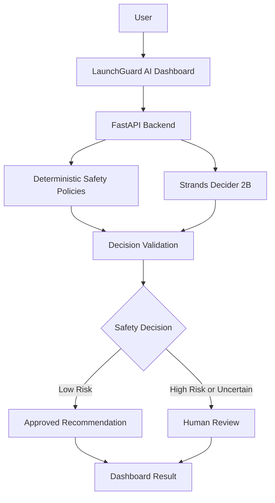

# 🛡️ LaunchGuard AI
### The Safety Gate for Cloud Changes

**LaunchGuard AI** is an AI-powered safety assistant that checks proposed cloud changes before they are carried out.

It helps teams identify risky actions, understand potential problems, and decide when human approval is needed.

Instead of allowing every action automatically, LaunchGuard AI combines AI-based decisions with clear safety rules to support safer cloud operations.

> **Core idea:** Check first. Decide carefully. Act safely.

---

## 🚨 The Problem

A small mistake in a cloud environment can cause service downtime, security issues, or unexpected costs.

For example:
- Deleting an important cloud resource.
- Making a risky change in a production environment.
- Applying a change without checking its impact.
- Allowing an AI agent to perform an unsafe action.

Teams need a simple way to check these risks before taking action.

## 💡 Our Solution

LaunchGuard AI acts as a safety checkpoint between a proposed cloud change and the next action.

It analyzes the request, evaluates risk, and recommends a safe next step.

Depending on the situation, it can:

- ✅ Allow a read-only safety check.
- ❓ Ask for more information.
- 🛑 Require human review for risky or uncertain decisions.

**LaunchGuard AI does not automatically execute cloud changes.** Its current prototype focuses on risk assessment and safe recommendations.

---

## ✨ Key Features

- **AI-Powered Decisions:** Uses Strands Decider 2B to evaluate possible actions.
- **Risk Assessment:** Checks factors such as environment and severity.
- **Safety Policies:** Applies deterministic rules alongside AI decisions.
- **Human Approval:** Flags risky or uncertain cases for review.
- **Fail-Safe Handling:** Requires review when the decision model is unavailable or returns an error.
- **Interactive Dashboard:** Displays risk assessments, decisions, confidence, and recommendations.
- **Automated Tests:** Tests important safety rules and failure scenarios.
- **Local Prototype:** Runs locally without requiring cloud resources for the current decision workflow.

---

## 🧠 How It Works

1. **Submit a Request** — The user describes a proposed cloud change.
2. **Evaluate the Risk** — The backend applies safety policies.
3. **Ask the Decision Model** — Strands Decider 2B evaluates the available actions.
4. **Combine the Results** — The system checks the model output against the safety rules.
5. **Make a Decision** — The system approves a safe recommendation or requests human review.
6. **Show the Result** — The dashboard displays the decision, confidence, reasons, and recommendations.

### Architecture



---

## 🛠️ Technology Stack

| Technology | Purpose |
|---|---|
| React + TypeScript | Frontend dashboard |
| Vite | Frontend development server |
| Python | Backend application |
| FastAPI | REST API |
| Strands Decider 2B | AI decision-making |
| Pydantic | Request and settings validation |
| Pytest | Automated testing |
| Git + GitHub | Version control and collaboration |

---

## 🔒 Safety First

LaunchGuard AI follows a simple principle: **uncertain decisions should not be treated as safe decisions.**

The current prototype uses multiple safety checks:

- Production and high-severity scenarios can require human review.
- Low-confidence AI decisions can require human review.
- AI model failures trigger a fail-safe response.
- AI recommendations do not directly execute cloud changes.

These controls are intended to reduce risk. They do not guarantee that every decision will be correct.

---

## 🚀 Getting Started

### Prerequisites

Install the following tools:

- Python 3.14 or a compatible Python version
- Node.js and npm
- Git

The local Strands Decider 2B model must also be available to run the complete decision workflow.

### 1. Clone the Repository

```bash
git clone https://github.com/dasu07988/LaunchGuard-AI.git
cd LaunchGuard-AI

```

### 2. Create and Activate the Python Environment

On Windows PowerShell:

```powershell
python -m venv .venv
.\.venv\Scripts\Activate.ps1
```

### 3. Install Python Dependencies

```powershell
python -m pip install -r requirements.txt
```

If the Strands Decider package is not installed by the requirements file, install it separately:

```powershell
python -m pip install strands-decider
```

### 4. Start Strands Decider 2B

Download or make the model available locally, then start the decision service:

```powershell
strands-decider serve StrandsAgents/strands-decider-2B-hobson-v21 --host 127.0.0.1 --port 8001 --device cpu
```

Keep this terminal open.

### 5. Start the Backend

Open a second terminal in the project root:

```powershell
.\.venv\Scripts\Activate.ps1
$env:PYTHONPATH = "backend"
uvicorn app.main:app --reload --port 8000
```

Backend API: `http://127.0.0.1:8000`

API documentation: `http://127.0.0.1:8000/docs`

### 6. Start the Frontend

Open a third terminal:

```powershell
cd frontend
npm install
npm run dev
```

Open the local URL shown in the terminal, usually:

`http://localhost:5173`

Keep all three services running while using the dashboard.

---

## 🔌 API Endpoints

| Method | Endpoint | Purpose |
|---|---|---|
| GET | `/` | Basic application information |
| GET | `/health` | Backend health check |
| POST | `/api/v1/decisions` | Evaluate a proposed change |
| POST | `/api/v1/decisions/preview` | Preview a decision |

Open `/docs` on the backend to inspect the available request and response schemas.

---

## 🧪 Running Tests

From the project root, activate the virtual environment and run:

```powershell
$env:PYTHONPATH = "backend"
python -m pytest tests/ -v
```

The tests cover safety policies, human-review decisions, low-confidence results, and model failures.

---

## 📸 Screenshots and Demo

Screenshots and a short demonstration video can be added here.

The demo should show:

1. Submitting a proposed cloud change.
2. Viewing the risk assessment.
3. Seeing the AI decision and confidence.
4. Understanding why human review is required.

---

## 🗺️ Roadmap

- [x] Build the initial project structure.
- [x] Integrate Strands Decider 2B.
- [x] Add deterministic safety policies.
- [x] Add automated decision tests.
- [x] Build the interactive dashboard.
- [ ] Add and test Amazon Bedrock integration.
- [ ] Improve decision audit logs and reporting.
- [ ] Publish a short demonstration video.
- [ ] Prepare the hackathon article and final submission.

---

## ⚠️ Current Limitations

LaunchGuard AI is an evolving prototype.

- The current decision workflow uses a locally hosted Strands Decider 2B model.
- Amazon Bedrock explanation generation is optional and remains disabled by default until explicitly configured and tested.
- Cloud changes are not executed automatically; the application provides risk assessments and recommendations only.
- Decision quality depends on the information provided and the behavior of the decision model.
- A passing test suite does not guarantee that every real-world cloud scenario will be classified correctly.
- Human review remains important for high-risk, uncertain, or unexpected situations.

---

## 🤝 Contributing

Contributions, bug reports, and suggestions are welcome. Please open an issue to discuss a significant change before submitting a pull request.

## 📄 License

This project is licensed under the MIT License. See the `LICENSE` file for details.

---

## 🏷️ Hackathon

Built for the Agent Experience Hackathon: Strands Decider.

`#strands-decider-2b` `#guardrails`