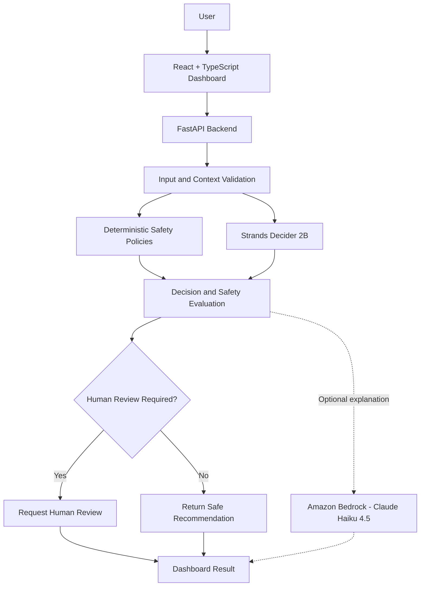

# 🛡️ LaunchGuard AI
### The Safety Gate for Cloud Changes

**Check first. Decide carefully. Act safely.**

LaunchGuard AI is an AI-powered cloud operations safety assistant that evaluates proposed cloud changes before they are carried out. It combines **Strands Decider 2B**, deterministic safety policies, and optional **Amazon Bedrock** explanations to help teams identify risks and decide when human approval is needed.

Instead of allowing every proposed action automatically, LaunchGuard AI acts as a safety checkpoint between a request and the next action.

> **Core principle:** AI can recommend a decision, but safety rules and human oversight help control what happens next.

LaunchGuard AI is an educational prototype. It evaluates risks and provides recommendations; it does not automatically execute cloud infrastructure changes.

---

## 📌 Table of Contents

- [The Problem](#-the-problem)
- [Our Solution](#-our-solution)
- [Key Features](#-key-features)
- [Architecture](#️-architecture)
- [Technology Stack](#️-technology-stack)
- [How It Works](#-how-it-works)
- [Safety and Guardrails](#-safety-and-guardrails)
- [Amazon Bedrock Integration](#-amazon-bedrock-integration)
- [Getting Started](#-getting-started)
- [API Reference](#-api-reference)
- [Running Tests](#-running-tests)
- [Demo Scenarios](#-demo-scenarios)
- [Current Limitations](#️-current-limitations)
- [Roadmap](#️-roadmap)
- [Contributing](#-contributing)
- [License](#-license)
- [Hackathon](#-hackathon)

---

## 🚨 The Problem

A small mistake in a cloud environment can cause service downtime, security issues, data loss, or unexpected costs.

Examples include:

- Deleting an important cloud resource.
- Applying a risky change in a production environment.
- Modifying infrastructure without checking its potential impact.
- Allowing an AI agent to recommend an unsafe action without appropriate review.
- Acting on incomplete information or an unreliable model response.

Teams need a practical way to evaluate proposed changes before taking action.

## 💡 Our Solution

LaunchGuard AI provides a safety gate for proposed cloud operations.

It evaluates a request, considers the operating environment and incident severity, consults a decision model, and applies safety policies before returning a recommendation.

Depending on the situation, LaunchGuard AI can:

- ✅ Allow a read-only safety check.
- ❓ Ask for clarification when more information is needed.
- 🛑 Require human review for risky or uncertain decisions.
- 🔒 Fail safely when the decision model is unavailable or produces an unusable result.
- 📝 Use Amazon Bedrock to generate a plain-language explanation of the decision when enabled.

The current prototype focuses on **risk assessment, decision support, and human oversight** rather than automatic infrastructure execution.

## ✨ Key Features

### 🧠 AI-Powered Decision-Making
Uses Strands Decider 2B to evaluate available actions and provide decision-related signals, including confidence information.

### ⚖️ Risk Assessment
Evaluates proposed operations using context such as the target environment and incident severity.

### 🛡️ Deterministic Safety Policies
Combines model recommendations with explicit safety rules to reduce the chance of blindly accepting an unsafe recommendation.

### 👤 Human-in-the-Loop Decisions
Flags risky or uncertain scenarios for human review.

### 🔒 Fail-Safe Behaviour
Requires human review when the decision model is unavailable or a decision cannot be trusted.

### ☁️ Amazon Bedrock Explanations
Optionally uses Claude Haiku 4.5 through Amazon Bedrock to explain a decision in understandable language.

### 📊 Interactive Dashboard
Displays the proposed scenario, risk score, decision, confidence, and recommendation.

### 🧪 Automated Testing
Includes tests for API endpoints, safety policies, low-confidence decisions, model failure, and human-review behaviour.

### 💻 Local Development
The core decision workflow can run locally with the Strands Decider service. Amazon Bedrock is an optional cloud dependency for explanation generation.

---

## 🏗️ Architecture



### Architectural Components

| Component | Responsibility |
|---|---|
| React + TypeScript | User interface and risk dashboard |
| FastAPI | REST API and request handling |
| Pydantic | Request and settings validation |
| Strands Decider 2B | AI-based decision evaluation |
| Deterministic safety policies | Enforce application-defined safety rules |
| Amazon Bedrock | Optional natural-language explanations |
| Pytest | Automated verification of application behaviour |

### Reusable Decision Pattern

LaunchGuard AI demonstrates a reusable **Guardrails Decision Gate** pattern:

1. Receive a proposed operation and its context.
2. Validate the request.
3. Evaluate the risk using model signals and deterministic rules.
4. Check whether the decision is sufficiently safe.
5. Request human review when risk, uncertainty, or failure warrants it.
6. Return a structured decision and an optional explanation.
7. Leave actual execution to a separately authorised workflow.

This pattern can be adapted to deployment approvals, infrastructure change reviews, cloud operations, and other workflows where an unsafe automated decision could have consequences.

---

## 🔄 How It Works

1. **Submit a request:** A user describes a proposed cloud operation.
2. **Validate the context:** The backend receives the scenario, environment, and severity.
3. **Evaluate the decision:** Strands Decider 2B evaluates the available actions.
4. **Apply safety rules:** Deterministic policies check the context and model output.
5. **Choose a safe next step:** The system approves an eligible read-only recommendation or requires human review.
6. **Explain the result:** Amazon Bedrock can generate an optional plain-language explanation.
7. **Display the decision:** The dashboard presents the risk assessment, confidence, and recommendation.

The model's recommendation is not treated as permission to execute a cloud change.

---

## 🛡️ Safety and Guardrails

LaunchGuard AI follows a simple principle:

> Uncertain decisions should not automatically be treated as safe decisions.

The prototype includes safeguards for:

- Production operations with high severity.
- Low-confidence model decisions.
- Model responses that signal a need for human review.
- Missing or unavailable decision-model responses.
- Unknown or insufficient context.

When the application cannot establish that a decision is safe enough, it can require human review.

**Important:** These safeguards reduce risk but do not guarantee that every real-world scenario will be classified correctly. The application does not execute infrastructure changes automatically.

---

## ☁️ Amazon Bedrock Integration

LaunchGuard AI optionally integrates with **Amazon Bedrock using Anthropic Claude Haiku 4.5** to generate a human-readable explanation of a decision.

The Strands Decider 2B model is responsible for the decision workflow. Bedrock is used for explanation generation, not as a replacement for the deterministic safety policies.

### Explanation Workflow

1. The backend obtains a decision from the decision workflow.
2. A bounded explanation prompt is constructed from the scenario and decision details.
3. The backend sends the prompt to Amazon Bedrock when the integration is enabled.
4. The generated explanation is returned to the dashboard when available.
5. If explanation generation fails, the application can continue without the optional explanation.

The explanation must not override the safety decision or authorise an infrastructure change.

### Configuration

The current configuration uses the following settings:

| Setting | Example |
|---|---|
| `BEDROCK_ENABLED` | `true` to enable |
| `AWS_REGION` | `us-east-1` |
| `BEDROCK_MODEL_ID` | `us.anthropic.claude-haiku-4-5-20251001-v1:0` |

The model identifier must match a model or inference profile available to your AWS account and region.

### AWS Prerequisites

Before using Bedrock:

- Configure AWS credentials using an appropriate AWS credential provider.
- Ensure the selected region supports the model or inference profile.
- Ensure the AWS identity has the required Bedrock invocation permissions.
- Complete any required Anthropic use-case submission and model agreement steps.
- Confirm that the selected model is available to the account.

See the [Amazon Bedrock documentation](https://docs.aws.amazon.com/bedrock/latest/userguide/model-parameters-claude.html) for model request details and the [model access guide](https://docs.aws.amazon.com/bedrock/latest/userguide/model-access.html) for access prerequisites.

### Cost and Security

Amazon Bedrock usage can incur charges. Keep explanation generation disabled when it is not needed, avoid unnecessary repeated requests, and review AWS billing and model pricing before using the integration extensively.

Do not commit AWS credentials, secret keys, or `.env` files to GitHub.

---

## 🛠️ Technology Stack

| Technology | Purpose |
|---|---|
| React + TypeScript | Frontend dashboard |
| Vite | Frontend development server |
| Python | Backend application |
| FastAPI | REST API |
| Pydantic | Request and configuration validation |
| Strands Decider 2B | Decision model |
| Amazon Bedrock | Optional generative explanations |
| Boto3 | AWS SDK for Python |
| Pytest | Automated testing |
| Git + GitHub | Version control and collaboration |

---

## 🚀 Getting Started

### Prerequisites

Install:

- Python 3.14 or a compatible Python version.
- Node.js and npm.
- Git.
- AWS CLI and configured credentials if using Amazon Bedrock.
- The local Strands Decider 2B model for the complete local decision workflow.

### 1. Clone the Repository

```bash
git clone https://github.com/dasu07988/LaunchGuard-AI.git
cd LaunchGuard-AI
```

### 2. Create a Python Virtual Environment

On Windows PowerShell:

```powershell
python -m venv .venv
.\.venv\Scripts\Activate.ps1
```

If PowerShell prevents script activation, use an appropriate PowerShell execution policy for your environment or activate the environment from a supported terminal.

### 3. Install Backend Dependencies

```powershell
python -m pip install -r requirements.txt
```

If `strands-decider` is not included in `requirements.txt`, install it separately:

```powershell
python -m pip install strands-decider
```

Use the dependency versions specified by the repository where available.

### 4. Start Strands Decider 2B

Make sure the model is available locally, then run:

```powershell
strands-decider serve StrandsAgents/strands-decider-2B-hobson-v21 --host 127.0.0.1 --port 8001 --device cpu
```

Keep this terminal open while using the dashboard.

The model may require a substantial initial download and local disk space.

### 5. Start the Backend

Open a second PowerShell terminal in the project root:

```powershell
.\.venv\Scripts\Activate.ps1
$env:PYTHONPATH = "backend"
uvicorn app.main:app --reload --host 127.0.0.1 --port 8000
```

Backend URL:

`http://127.0.0.1:8000`

Interactive API documentation:

`http://127.0.0.1:8000/docs`

Health check:

`http://127.0.0.1:8000/health`

#### Enable Amazon Bedrock (Optional)

In the backend terminal, set the configuration before starting or restarting the backend:

```powershell
$env:BEDROCK_ENABLED = "true"
$env:AWS_REGION = "us-east-1"
$env:BEDROCK_MODEL_ID = "us.anthropic.claude-haiku-4-5-20251001-v1:0"
```

Ensure that the backend configuration reads these environment variables and that AWS credentials are configured.

For example, if using the AWS CLI with an existing configured profile:

```powershell
aws sts get-caller-identity
```

This checks which AWS identity is being used; it does not make a Bedrock inference request.

If the application is configured to load these values from a `.env` file, use the variable names and defaults defined in `backend/app/config.py`. Environment variables set in PowerShell apply to that terminal session.

**Note:** The current default configuration disables Bedrock. Set `BEDROCK_ENABLED=true` explicitly when you want the backend to request explanations.

### 6. Start the Frontend

Open a third terminal:

```powershell
cd frontend
npm install
npm run dev
```

Open the local URL displayed by Vite, usually:

`http://localhost:5173`

Keep the required services running while using the dashboard.

---

## 🔌 API Reference

The backend exposes the following endpoints:

| Method | Endpoint | Purpose |
|---|---|---|
| `GET` | `/` | Basic application information |
| `GET` | `/health` | Backend health check |
| `POST` | `/api/v1/decisions` | Evaluate a proposed operation |
| `POST` | `/api/v1/decisions/preview` | Preview a decision |

Open `http://127.0.0.1:8000/docs` to inspect the actual request and response schemas.

### Example Decision Request

```json
{
  "scenario": "Check application health using read-only diagnostics.",
  "context": {
    "environment": "development",
    "severity": "low"
  }
}
```

The exact response depends on the request, model output, and safety policies. Consult the running API documentation for the response schema.

---

## 🧪 Running Tests

From the repository root, activate the virtual environment and set the backend import path:

```powershell
.\.venv\Scripts\Activate.ps1
$env:PYTHONPATH = "backend"
python -m pytest -v
```

The current test suite includes checks for:

- API health and root endpoints.
- Decision and preview endpoints.
- Invalid request validation.
- Production and high-severity review requirements.
- Low-risk non-production decisions.
- Low model confidence.
- Model human-review signals.
- Fail-safe behaviour when the decision model fails.
- Unknown-context safety handling.

**Latest recorded local test result:** 13 tests passed.

This result represents the test run performed during development. Run the tests again after changing code or dependencies.

The tests use mocked decision responses in relevant cases, so passing tests does not mean that every test makes a live request to Strands Decider 2B or Amazon Bedrock.

---

## 🎬 Demo Scenarios

A short demonstration can show how LaunchGuard AI handles different risk levels.

### Scenario 1: Production + High Severity

Proposed operation:

`Restart a critical production service to resolve a high-severity incident.`

Show the risk assessment and the requirement for human review.

### Scenario 2: Development + Critical Severity

Proposed operation:

`Investigate a critical incident in the development environment using read-only diagnostics.`

Show how the model recommendation and final safety decision may differ.

### Scenario 3: Development + Low Severity

Proposed operation:

`Check application health and review development logs using read-only diagnostics.`

Show how the system can allow an eligible read-only recommendation.

### Suggested Demo Flow

1. Introduce the problem and the safety-gate concept.
2. Submit a low-risk scenario and show the result.
3. Submit a high-risk scenario and show human review.
4. Explain how Strands Decider 2B and deterministic policies work together.
5. Show the optional Bedrock explanation.
6. Finish by emphasising that the prototype does not execute cloud changes automatically.

Keep the published demonstration under three minutes if that is required by the hackathon.

**Demo video:** Add the public video URL here after publishing it.

---

## ⚠️ Current Limitations

LaunchGuard AI is an evolving prototype.

- The core decision workflow uses a locally hosted Strands Decider 2B model.
- Amazon Bedrock explanation generation is optional and disabled by default.
- Bedrock access depends on AWS configuration, account permissions, model availability, and applicable model access requirements.
- Cloud infrastructure changes are not executed automatically.
- The system relies on the quality of the submitted scenario and context.
- Model confidence is not a guarantee of correctness.
- The safety policies do not guarantee detection of every unsafe action.
- The current automated tests do not exhaustively cover every possible real-world scenario.
- The preview endpoint currently uses the same decision function as the main decision endpoint.

Use human judgement and appropriate operational controls for real infrastructure changes.

---

## 🗺️ Roadmap

### Implemented in the Current Prototype

- [x] Create the application structure.
- [x] Integrate the local Strands Decider 2B workflow.
- [x] Implement deterministic safety policies.
- [x] Add decision and API tests.
- [x] Build the interactive dashboard.
- [x] Implement optional Amazon Bedrock explanation support.
- [x] Test representative risk and human-review scenarios.


---

## 🤝 Contributing

Contributions, bug reports, and suggestions are welcome.

For significant changes, open an issue to discuss the proposal before submitting a pull request. Contributions should preserve the safety-first design and include tests for relevant behaviour.

## 📄 License

This project is intended to be distributed under the MIT License. See the [`LICENSE`](LICENSE) file for the full license text.

## 🏆 Hackathon

Built for the **Agent Experience Hackathon: Strands Decider**.

The project demonstrates a reusable guardrails decision pattern combining Strands Decider 2B, deterministic safety rules, human oversight, and optional Amazon Bedrock explanations.

### Required Tags

`#strands-decider-2b` `#guardrails`

---

**LaunchGuard AI — Check first. Decide carefully. Act safely.**
